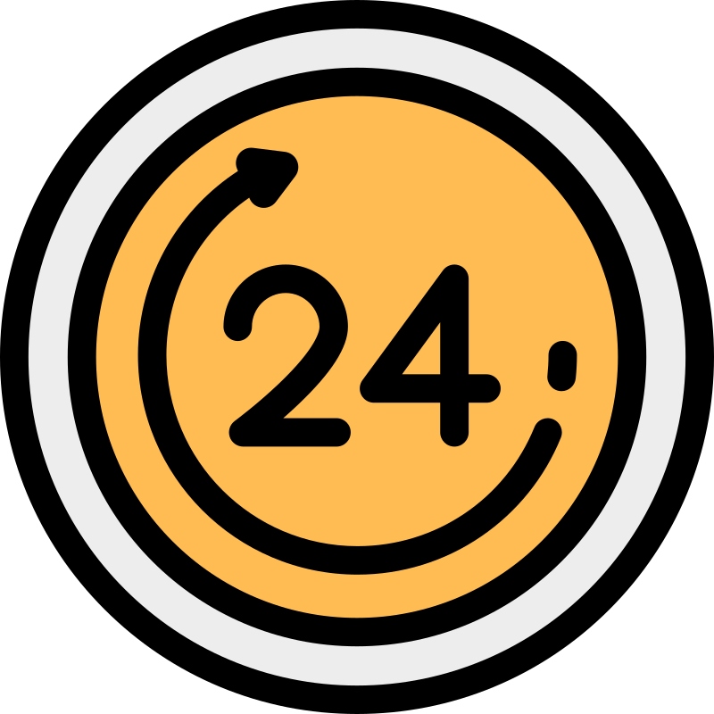
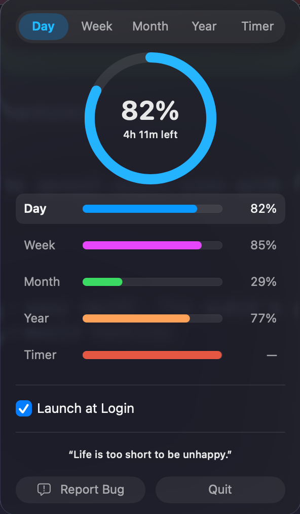
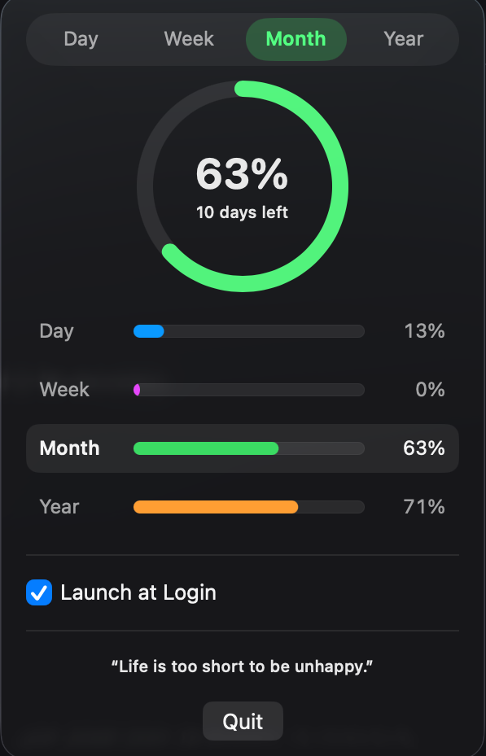
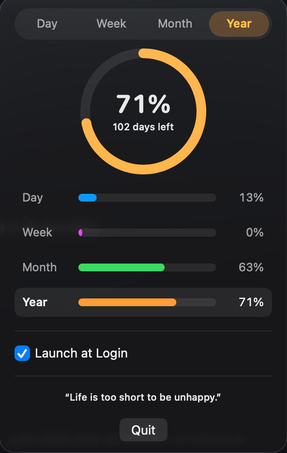

# Time Left — Menu Bar, 100% On-Device 🔒

<p align="center">
  
</p>

> “Don’t waste your time in anger, regrets, worries, and grudges. Life is too short to be unhappy.”
> — Roy T. Bennett

Minimal macOS menu bar app that shows how much of your **day / month / year** has passed. No network, no tracking, no data leaves your Mac.

  

## 🤔 What is this?

**Time Left is a tiny app that reminds you life is passing — in a good way.**

It lives quietly in your macOS menu bar as a small `⏳ Y: 71%` icon. Click it and you get a popover with an **animated progress ring** showing how much of the **day, month, or year** has already passed — and how much is left, in plain numbers ("104 days left"). Pick the scope you care about, tick **Launch at Login**, and let it sit there as a gentle nudge to make the rest count.

- 🕐 **Day** — "20h 35m left of today"
- 📅 **Month** — "12 days left"
- 🗓️ **Year** — "104 days left"
- 🔋 **~0.5 MB, no window, no dock icon, no network** — it just works, all day, on every Mac from macOS 13+ (Apple Silicon and Intel)

For anyone who likes a quiet reminder that time is the one thing you can't get back. ⏳

## 📸 Screenshots

<p align="center">
  
  &nbsp;
  
  &nbsp;
  
</p>
<p align="center"><i>Day • Month • Year — switch scopes with the pills, the ring and menu-bar label follow. <b>Launch at Login</b> keeps Time Left running from day one.</i></p>

## Install (one file)

1. Build or grab `dist/TimeLeft.dmg` from a release (universal binary — Apple Silicon and Intel)
2. Double-click → drag `TimeLeft.app` → `Applications`
3. Open `TimeLeft` — find `⏳ Y: 71%` in menu bar → click for Day/Month/Year scopes, animated ring, and the Launch-at-Login toggle

> 🔒 **Privacy friendly — absolutely nothing leaves this machine.** All calculations run locally in `YearPassing/TimeCalculations.swift` using `Calendar.current`. No `URLSession`, no analytics.

## ⚠️ macOS blocked the app?

If macOS shows *"TimeLeft can't be opened because it is from an unidentified developer"* or *"damaged and can't be opened"* (common for unsigned apps downloaded from the internet), remove the quarantine flag and open it:

```bash
xattr -cr /Applications/TimeLeft.app
```

Then open the app normally. This only clears Gatekeeper's quarantine attribute — the app is fully local and touches nothing outside your Mac.

## Swift only, butter smooth

* **Pure SwiftUI** — `MenuBarExtra` + `ProgressView` + `Calendar` (no JS/Python/deps, `otool -L` shows only `SwiftUI/AppKit/Foundation`)
* **Selectable scope** — Day/Month/Year pills + rows; choice persists via `@AppStorage`; tray label follows (`D: 64%` / `M: 55%` / `Y: 71%`)
* **Launch at Login** — checkbox in the popover, backed by `SMAppService`
* **Timed** — refreshes every 60s via `Timer.publish`

## Dev

```bash
# build the app bundle (build/.apps/TimeLeft.app — hidden so Launchpad shows only /Applications)
./scripts/build.sh

# rebuild the DMG (dist/TimeLeft.dmg with privacy footer background)
./scripts/build-dmg.sh
```

## Structure

```
scripts/build.sh            // swiftc → build/.apps/TimeLeft.app
scripts/build-dmg.sh        // gen_bg.swift + hdiutil → dist/TimeLeft.dmg
scripts/gen_bg.swift        // 660×400 DMG background (“100% on-device • No network… ”)
YearPassing/YearPassingApp.swift   // MenuBarExtra: pills, ring hero, selectable rows, launch-at-login toggle
YearPassing/TimeCalculations.swift// pure Calendar math + Scope enum
YearPassing/Info.plist            // LSUIElement, AppIcon
```

MIT — build locally, share the DMG.
