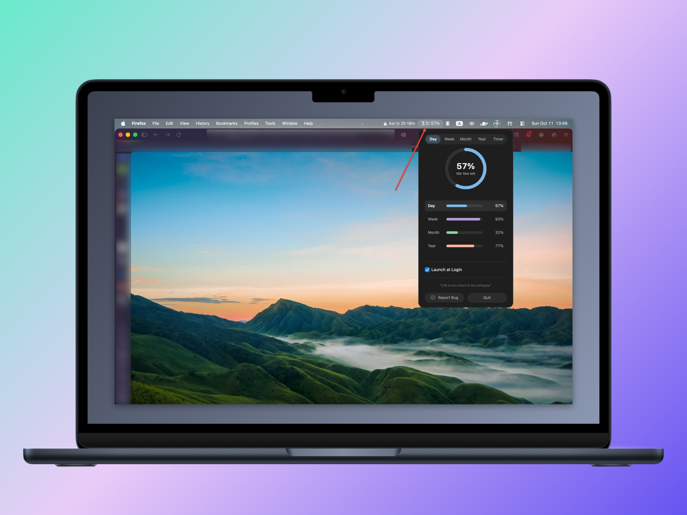

# Time Left — Menu Bar, 100% On-Device 🔒

<p align="center">
  
</p>

> “Don’t waste your time in anger, regrets, worries, and grudges. Life is too short to be unhappy.”
> — Roy T. Bennett

Minimal macOS menu bar app that shows how much of your **day / week / month / year** has passed — plus a **built-in countdown timer** (5m–1h). No network, no tracking, no data leaves your Mac.

  

## 🤔 What is this?

**Time Left is a tiny app that reminds you life is passing — in a good way.**

It lives quietly in your macOS menu bar as a small `⏳ Y: 71%` icon. Click it and you get a popover with an **animated progress ring** showing how much of the **day, month, or year** has already passed — and how much is left, in plain numbers ("104 days left"). Pick the scope you care about, tick **Launch at Login**, and let it sit there as a gentle nudge to make the rest count.

- 🕐 **Day** — "20h 35m left of today"
- 📅 **Week** — "3 days left"
- 📅 **Month** — "12 days left"
- 🗓️ **Year** — "104 days left"
- ⏱️ **Timer** — pick 5/10/15/30/60 min and the menu bar counts down live (`9:41`, or `1:04:09` for an hour+). Persists across quit/relaunch, gentle notification when time's up
- 🔋 **~700 KB download, no window, no dock icon, no network** — it just works, all day, on every Mac from macOS 13+ (Apple Silicon and Intel)

For anyone who likes a quiet reminder that time is the one thing you can't get back. ⏳

## 📸 Screenshot

<p align="center">
  
</p>
<p align="center"><i>One panel, every scope — pick with the <b>pills</b> on top; the rows, the ring and the menu-bar label always agree. Each scope has its own colour, and <b>Launch at Login</b> keeps Time Left running from day one.</i></p>

## Install (one file)

1. Build or grab `dist/TimeLeft.dmg` from a release (universal binary — Apple Silicon and Intel)
2. Double-click → drag `TimeLeft.app` → `Applications`
3. Open `TimeLeft` — find `⏳ Y: 71%` in menu bar → click for Day/Week/Month/Year scopes, the countdown Timer, animated ring, and the Launch-at-Login toggle

### 🍺 Or install with Homebrew

Tap once, then install with the short name — from then on it's just `time-left`:

```bash
brew tap sabuz796/tap                 # once, ever
brew install --cask time-left
```

Or skip the tap and do it in a single command:

```bash
brew install --cask sabuz796/tap/time-left
```

Either way, update later with:

```bash
brew upgrade --cask time-left
```

Homebrew picks up every new release automatically. Clear Gatekeeper's quarantine flag once after the first install (see below), then open the app.

> 🔒 **Privacy friendly — absolutely nothing leaves this machine.** All calculations run locally in `YearPassing/TimeCalculations.swift` using `Calendar.current`. No `URLSession`, no analytics.

## ⚠️ macOS blocked the app?

If macOS shows *"TimeLeft can't be opened because it is from an unidentified developer"* or *"damaged and can't be opened"* (common for unsigned apps downloaded from the internet), remove the quarantine flag and open it:

```bash
xattr -d com.apple.quarantine /Applications/TimeLeft.app
```

If macOS still complains, `xattr -cr /Applications/TimeLeft.app` clears *all* extended attributes instead.

Then open the app normally. This only clears Gatekeeper's quarantine attribute — the app is fully local and touches nothing outside your Mac.

## Swift only, butter smooth

* **Pure SwiftUI** — `MenuBarExtra` + `ProgressView` + `Calendar` (no JS/Python/deps, `otool -L` shows only SwiftUI/AppKit/Foundation plus ServiceManagement and UserNotifications)
* **Selectable scope** — Day/Week/Month/Year/Timer pills at the top pick the scope; the rows below show every calendar scope at once, each with its own colour (blue/purple/green/coral). Choice persists via `@AppStorage`; tray label follows (`D: 64%` / `W: 57%` / `M: 55%` / `Y: 71%`)
* **Countdown timer** — presets 5/10/15/30/60 min; menu bar shows `m:ss` (or `h:mm:ss` for 1h+) only while a timer runs; end date is persisted so the countdown survives quit/relaunch; "Time's up" notification on finish
* **Launch at Login** — checkbox in the popover, backed by `SMAppService`
* **Week respects your locale** — the week starts on `Calendar.current.firstWeekday`, not hardcoded Sunday

## Dev

```bash
# run the math self-check (no framework, no deps — swiftc + run)
./scripts/test.sh

# build + run instantly (no install) — your edit-test loop
./scripts/dev.sh

# build the app bundle (build/.apps/TimeLeft.app — hidden so Launchpad shows only /Applications)
./scripts/build.sh

# rebuild the DMG (dist/TimeLeft.dmg)
./scripts/build-dmg.sh
```

## Releasing

```bash
# tag a release (triggers GitHub Actions → builds DMG + publishes release automatically)
git tag v1.3.1
git push origin v1.3.1
```

Or manually: `./scripts/build-dmg.sh` → GitHub → Releases → New release → attach `dist/TimeLeft.dmg`.

## Structure

```
scripts/build.sh            // swiftc → build/.apps/TimeLeft.app (universal, re-signed)
scripts/test.sh             // swiftc + run the calendar/timer self-check
scripts/dev.sh              // build + run without installing
scripts/build-dmg.sh        // hdiutil → dist/TimeLeft.dmg
scripts/gen_icon.swift      // app icon generator (run by build.sh)
YearPassing/YearPassingApp.swift   // MenuBarExtra: ring hero, scope rows, countdown timer, launch-at-login toggle
YearPassing/TimeCalculations.swift// pure Calendar math + Scope enum + TimerLogic
YearPassing/Info.plist            // LSUIElement, AppIcon
tests/TimeCalculationsTests.swift // 36 checks over the calendar + timer math
```

MIT — build locally, share the DMG.
